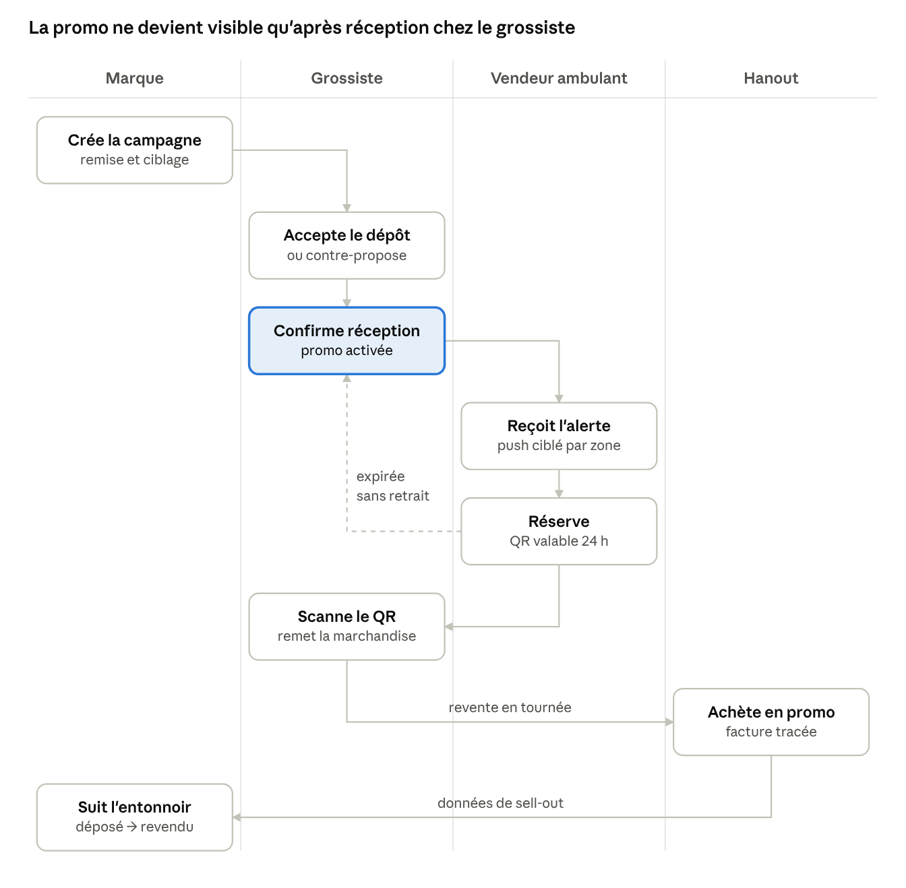
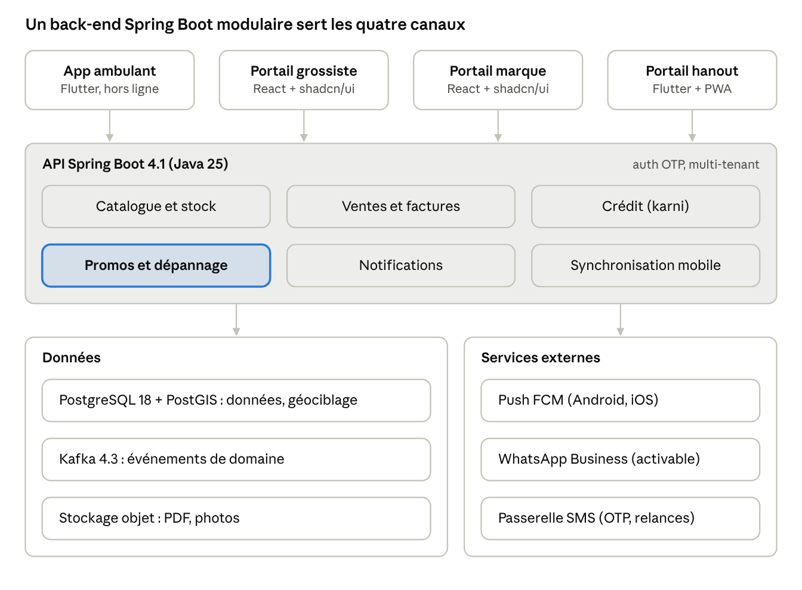

# Cahier des charges — Daba, plateforme des grossistes ambulants

Nov 3, 2026 · @Yazid Aqel · Version 0.2 — document de travail pour RED (red.ma). La version 0.1 date du 24 octobre 2026 ; la 0.2 reporte les décisions prises pendant le lot 1 (§9, §10, §11, §14).

## 1. Contexte et objectifs

Daba digitalise l'activité des vendeurs grossistes ambulants et crée un canal direct entre les marques, les grossistes et les hanouts. Daba réunit les solutions 4 (Kenach, le carnet de l'épicier) et 6 (Daba) de la note REDLAB v3 (octobre 2026), issue de la collaboration avec RED (red.ma).

**Constat terrain**

- Les épiciers achètent peu à la fois, selon leur trésorerie, et tombent vite en rupture ; ils dépendent d'ambulants qui passent au hasard.

- Le vendeur ambulant tourne à l'aveugle et gère son stock, ses ventes et le crédit de ses clients sur papier (carnet, « karni ») ou de mémoire.

- Les impayés par hanout sont mal suivis, ce qui génère des pertes et des litiges.

- Les remises des marques déposées chez les grossistes circulent par le bouche-à-oreille : l'ambulant les découvre tard ou jamais.

- Les marques n'ont presque aucune visibilité sur les ruptures et l'écoulement (sell-out) de leurs produits dans le commerce traditionnel.

**Objectifs**

1.  Permettre à l'épicier de signaler une rupture en deux clics et d'être dépanné par l'ambulant le plus proche qui a le produit.

2.  Donner au vendeur ambulant un outil simple pour gérer stock, ventes, factures et crédit client.

3.  Le notifier en temps réel des promotions disponibles chez les grossistes de sa zone.

4.  Offrir au grossiste un suivi de son stock, de ses dépôts promo et de ses ventes aux ambulants.

5.  Offrir aux marques un canal de diffusion des promotions, la carte des ruptures et des données de sell-out jusqu'au hanout.

6.  Donner au hanout l'accès à ses factures et à son solde, sans friction.

## 2. Acteurs et périmètre

Cinq profils utilisent la plateforme, chacun avec son canal d'accès.

| Acteur                                    | Rôle                                                                          | Canal                                                                 | Besoin principal                        |
|-------------------------------------------|-------------------------------------------------------------------------------|-----------------------------------------------------------------------|-----------------------------------------|
| Vendeur ambulant                          | Achète chez le grossiste, revend aux hanouts en tournée                       | App mobile (Android en priorité)                                      | Stock, factures, crédit, alertes promo  |
| Grossiste                                 | Stocke et revend aux ambulants, reçoit les dépôts promo des marques           | Portail web + app mobile légère                                       | Stock, ventes, confirmation des dépôts  |
| Grand client (marque ou distributeur)     | Lance les remises, choisit les grossistes dépositaires                        | Portail web                                                           | Diffusion des promos, suivi du sell-out |
| Hanout                                    | Achète auprès de l'ambulant, tient le carnet de crédit de ses propres clients | Application mobile, ou appli web légère (PWA) sans installation + SMS | Signaler une rupture, factures, solde   |
| Administrateur plateforme (RED / éditeur) | Gère les comptes, le référentiel produits et POS, la facturation SaaS         | Back-office web                                                       | Onboarding, modération, support         |

**Dans le périmètre**

- Gestion de stock (grossiste et stock embarqué de l'ambulant).

- Ventes, facturation et encaissements de l'ambulant vers le hanout.

- Suivi du crédit et des impayés par hanout.

- Dépannage des hanouts en rupture par l'ambulant le plus proche, et cycle de vie complet des promotions marque → grossiste → ambulant → hanout.

- Notifications push et SMS.

- Tableaux de bord par portail.

**Hors périmètre (version 1)**

- Paiement mobile intégré (wallet) : prévu en lot ultérieur.

- Volet consommateur de Kenach (panier, épiciers proches qui livrent) : lot ultérieur.

- Comptabilité complète et déclarations fiscales du grossiste.

- Optimisation automatique des itinéraires de tournée.

- Marketplace ouverte entre grossistes.

## 3. Application vendeur ambulant

L'application mobile est l'outil quotidien du vendeur : elle doit fonctionner hors ligne, en arabe dialectal et en français, et se manipuler d'une main.

### 3.1 Compte et profil

- Inscription par numéro de téléphone + OTP SMS.

- Profil : nom, CIN (optionnel), ICE si auto-entrepreneur ou société, véhicule, zones couvertes, catégories vendues.

- Rattachement à un ou plusieurs grossistes fournisseurs.

### 3.2 Stock embarqué

- Chargement : réception d'un bon de sortie du grossiste (scan QR) ou saisie manuelle.

- Stock en temps réel décrémenté à chaque vente.

- Retours hanout (produit abîmé, périmé) et retours au grossiste.

- Inventaire de fin de journée avec calcul des écarts.

- Alertes de rupture et de date de péremption proche.

### 3.3 Hanouts et tournée

- Fiche hanout, pré-remplie depuis la base POS fournie par RED : nom, gérant, téléphone, position GPS, photo de façade, ICE si disponible.

- Recherche par nom, téléphone ou carte.

- Tournées planifiées par jour de la semaine, avec liste ordonnée des hanouts à visiter.

- Historique des visites et des ventes par hanout.

### 3.4 Vente et facturation

- Prise de commande rapide : catalogue avec photos, favoris du hanout, dernière commande en un clic.

- Prix : tarif standard, tarif négocié par hanout, remise ponctuelle avec plafond.

- Modes de règlement : espèces, crédit, chèque, paiement partiel.

- Bon de livraison numéroté par défaut (facture en option si l'ambulant a un ICE), imprimé en Bluetooth, envoyé par SMS (lien) ou partagé en PDF depuis le téléphone (WhatsApp, en manuel).

- Signature ou confirmation du hanout sur l'écran.

### 3.5 Crédit et impayés (« karni » digital)

- Solde par hanout, historique chronologique des achats et versements.

- Plafond de crédit et délai maximal configurables par hanout.

- Blocage ou avertissement à la vente si le plafond est dépassé.

- Relances automatiques par SMS avec lien vers le relevé ; partage manuel possible par WhatsApp.

- Vue globale : total des créances, ancienneté (0-15 j, 15-30 j, +30 j), top des hanouts débiteurs.

### 3.6 Promotions

- Fil des promotions actives dans ses zones et catégories.

- Détail : produit, remise, grossiste dépositaire, quantité restante, date de fin, distance.

- Réservation d'une quantité et retrait chez le grossiste par QR code.

- Revente au hanout avec traçabilité de la promo jusqu'à la facture.

### 3.7 Dépannage sur rupture

- Bouton « disponible » : l'ambulant reçoit des demandes uniquement quand il est en tournée et l'a activé.

- Alerte quand un hanout proche signale une rupture sur un produit qu'il a en stock embarqué.

- Détail de la demande : produit, quantité, distance, historique et solde du hanout.

- Accepter ou refuser ; le premier qui accepte prend la demande, les autres sont prévenus.

- Livraison convertie en vente et en facture en un clic, au comptant ou à crédit.

### 3.8 Tableau de bord

- Chiffre d'affaires du jour, de la semaine, du mois.

- Encaissements vs crédits accordés.

- Marge par produit et par hanout.

- Caisse de fin de journée (espèces attendues vs déclarées).

## 4. Portail grossiste

Le grossiste est le point physique où la promo devient réelle : sans sa confirmation de dépôt, aucune notification ne part vers les ambulants.

### 4.1 Stock

- Référentiel produits (code-barres EAN, conditionnement : unité, pack, carton), prix d'achat et de vente.

- Entrées (fournisseurs, dépôts marque), sorties (ventes aux ambulants), ajustements d'inventaire.

- Stock promo isolé du stock normal, rattaché à sa campagne.

- Import initial par fichier Excel.

### 4.2 Dépôts promotionnels

- Réception des propositions de dépôt envoyées par les marques : accepter, refuser, contre-proposer une quantité.

- Confirmation de réception physique (quantité réellement reçue, photo du bon de livraison).

- Suivi en temps réel : quantité déposée, réservée, retirée, restante.

- Gestion des retraits : scan du QR code de réservation de l'ambulant, validation de la quantité remise.

- Clôture de campagne et retour ou rachat du reliquat.

### 4.3 Ventes aux ambulants

- Bon de sortie / facture par ambulant, transmis automatiquement dans le stock embarqué de l'ambulant.

- Crédit accordé aux ambulants (même mécanique que le karni côté ambulant).

- Liste des ambulants rattachés, leur volume, leur régularité.

### 4.4 Tableau de bord

- Rotation du stock, ruptures, produits dormants.

- Volumes par ambulant et par campagne promo.

- Points gagnés sur les dépôts promo, échangeables plus tard contre d'autres promos des grands clients (aucune rémunération au lancement).

## 5. Portail marque / grand client

Le portail grand client, ouvert aux marques comme aux autres typologies de distributeurs, est la source de revenus principale : il permet de lancer une promo vers le commerce traditionnel et d'en mesurer l'effet jusqu'au hanout.

### 5.1 Création d'une campagne

- Produits concernés, type de remise (pourcentage, prix net, produit offert, palier de quantité).

- Période de validité, quantité totale, quantité maximale par ambulant.

- Ciblage : régions, villes, zones, catégories d'ambulants.

- Prix de revente conseillé au hanout, indicatif seulement : l'ambulant garde la marge au lancement.

### 5.2 Affectation aux grossistes

- Choix des grossistes dépositaires sur carte ou liste filtrée.

- Répartition des quantités par grossiste.

- Suivi des acceptations et des confirmations de réception.

### 5.3 Suivi et reporting

- Entonnoir de la campagne : déposé → réservé → retiré → revendu au hanout.

- Carte de couverture (hanouts atteints, zones non couvertes) et carte des ruptures en temps réel par produit et par zone.

- Vitesse d'écoulement par grossiste et par zone.

- Export Excel et connecteur Power BI (cohérent avec le reporting actuel de RED).

### 5.4 Données de ruptures et de sell-out

- Données agrégées et anonymisées des ruptures signalées et des ventes ambulant → hanout sur les produits de la marque, y compris hors promo, selon l'offre souscrite.

- Aucune donnée nominative sur les hanouts ou les ambulants sans leur consentement.

## 6. Application hanout

Le hanout utilise Daba par une application mobile (Android d'abord) ou, s'il ne veut rien installer, par une application web légère (PWA) ouverte depuis un lien reçu par SMS, avec connexion par code OTP, sans créer de mot de passe.

- Signalement d'une rupture en deux clics depuis l'application, ou par WhatsApp quand le canal est activé : produit (photo ou liste de ses achats habituels) et quantité.

- Suivi de la demande : acceptée par tel ambulant, en route, livrée.

- Carnet client (ex-Kenach) : crédit accordé à ses propres clients, versements, solde envoyé au client.

- Saisie de ses dépenses et vue d'ensemble de son activité.

- Liste de ses bons de livraison et factures par ambulant, téléchargeables en PDF.

- Solde dû à chaque ambulant et historique des versements.

- Confirmation de réception d'une livraison (ou signalement d'un écart).

- Précommande pour la prochaine visite de l'ambulant.

- Promotions en cours transmises par ses ambulants (prix public conseillé).

- Contestation d'un document ou d'un solde, avec notification à l'ambulant.

L'application mobile et la version web offrent les mêmes fonctions ; seule l'application mobile reçoit les notifications push.

## 7. Flux métier : dépannage et promotion

### 7.1 Flux dépannage sur rupture

C'est le parcours central de Daba : l'épicier en rupture est livré par l'ambulant le plus proche qui a le produit.

1.  L'épicier signale une rupture (application web du hanout, ou WhatsApp si le canal est activé).

2.  Daba sélectionne les ambulants disponibles dans le rayon qui ont le produit en stock déclaré.

3.  Ils sont alertés ; le premier qui accepte prend la demande.

4.  Sans acceptation dans le délai, le rayon s'élargit, puis l'épicier est prévenu.

5.  L'ambulant livre ; vente, facture et paiement (espèces ou crédit) sont enregistrés.

6.  La rupture et sa résolution alimentent la carte des ruptures des marques.

### 7.2 Flux promotion

La confirmation de réception par le grossiste est le pivot du flux : elle seule déclenche les notifications aux ambulants.

flux promotion · 4 acteurs, 8 étapes

Une réservation non retirée dans le délai revient au stock promo disponible du grossiste.

**États d'une campagne** : Brouillon → Proposée aux grossistes → Active (au moins un dépôt confirmé) → Épuisée ou Expirée → Clôturée (reliquat retourné ou racheté).

**États d'une réservation** : Réservée → Retirée (scan QR) ou Expirée → Revendue (liée à une facture hanout).

## 8. Règles de gestion

### 8.1 Stock

- RG-S1 : un stock ne peut pas devenir négatif ; une vente hors ligne qui créerait un négatif est enregistrée puis signalée en anomalie à la synchronisation.

- RG-S2 : chaque mouvement porte un type (chargement, vente, retour, ajustement, promo), un auteur, un horodatage et un identifiant d'appareil.

- RG-S3 : le stock promo est traçable par campagne, du dépôt grossiste jusqu'à la ligne de facture hanout.

- RG-S4 : un écart d'inventaire au-delà d'un seuil paramétrable exige un motif.

### 8.2 Crédit et impayés

- RG-C1 : le solde d'un hanout = somme des factures à crédit − somme des versements − avoirs.

- RG-C2 : un versement est imputé par défaut sur la facture la plus ancienne (FIFO), modifiable manuellement.

- RG-C3 : au-delà du plafond ou du délai, la vente à crédit est soit bloquée, soit autorisée avec avertissement, selon le paramétrage de l'ambulant.

- RG-C4 : une facture ne peut être supprimée ; seule l'émission d'un avoir l'annule.

### 8.3 Facturation

- RG-F1 : numérotation continue et sans trou par émetteur, avec un préfixe par appareil pour garantir l'unicité hors ligne.

- RG-F2 : le document par défaut est le bon de livraison ; une facture avec mentions obligatoires (ICE, IF, RC, TVA si assujetti) n'est émise que si le statut de l'ambulant le permet.

- RG-F3 : les prix promo et les remises apparaissent en ligne séparée avec référence de la campagne.

- RG-F4 : la plateforme doit pouvoir évoluer vers la facturation électronique exigée par la DGI.

### 8.4 Promotions

- RG-P1 : une promo n'est visible des ambulants qu'après confirmation de réception par au moins un grossiste.

- RG-P2 : une réservation expire si elle n'est pas retirée dans un délai paramétrable (par défaut 24 h) ; la quantité revient au disponible.

- RG-P3 : le plafond par ambulant défini par la marque est contrôlé à la réservation et au retrait.

- RG-P4 : le retrait n'est validé que par scan du QR code de réservation chez le grossiste concerné.

### 8.5 Dépannage

- RG-D1 : une demande n'est envoyée qu'aux ambulants disponibles, dans un rayon paramétrable, ayant le produit en stock déclaré.

- RG-D2 : le premier ambulant qui accepte obtient la demande ; elle disparaît pour les autres.

- RG-D3 : sans acceptation dans un délai paramétrable, le rayon s'élargit une fois, puis l'épicier est prévenu.

- RG-D4 : la livraison crée une vente liée à la demande, pour mesurer le taux et le délai de dépannage.

## 9. Notifications

Les alertes de rupture et de promo sont les fonctions différenciantes : elles doivent arriver vite, être ciblées et ne pas saturer l'ambulant.

| Déclencheur                                               | Destinataire                    | Canal                           | Priorité     |
|-----------------------------------------------------------|---------------------------------|---------------------------------|--------------|
| Rupture signalée par un hanout proche, produit en stock   | Ambulant disponible             | Push + SMS                      | Haute        |
| Demande acceptée, ambulant en route, livrée               | Hanout                          | SMS + appli web                 | Haute        |
| Aucun ambulant disponible après le délai                  | Hanout                          | SMS                             | Moyenne      |
| Promo confirmée chez un grossiste de sa zone              | Ambulant                        | Push (+ SMS si non lu sous 1 h) | Haute        |
| Promo bientôt épuisée (seuil restant) ou proche de sa fin | Ambulant ayant consulté l'offre | Push                            | Moyenne      |
| Réservation proche d'expirer                              | Ambulant                        | Push                            | Haute        |
| Proposition de dépôt d'une marque                         | Grossiste                       | Push + e-mail                   | Haute        |
| Retrait effectué / stock promo épuisé                     | Grossiste, marque               | Push, tableau de bord           | Moyenne      |
| Nouvelle facture émise                                    | Hanout                          | SMS avec lien                   | Moyenne      |
| Relance d'impayé                                          | Hanout                          | SMS                             | Paramétrable |
| Plafond de crédit atteint par un hanout                   | Ambulant                        | Push                            | Moyenne      |
| Rupture ou péremption proche du stock embarqué            | Ambulant, grossiste             | Push                            | Basse        |

**Ciblage d'une promo vers un ambulant**

- Zone : distance du grossiste dépositaire à la zone de tournée de l'ambulant (rayon paramétrable).

- Catégorie : l'ambulant vend la catégorie du produit ou a déjà acheté la marque.

- Fournisseur : priorité aux ambulants déjà rattachés au grossiste.

**Préférences**

- L'utilisateur choisit ses canaux, ses catégories et une plage horaire de silence.

- Les promos peu pertinentes sont regroupées dans un résumé quotidien plutôt qu'envoyées une par une.

**Canaux configurables**

- Daba envoie ses messages via une couche canaux unique : push, SMS et WhatsApp Business API.

- Chaque canal, SMS compris, s'active ou se désactive par paramétrage système, par organisation et par type de message, sans développement.

- Pour chaque type de message, l'administrateur choisit un canal principal et un canal de repli (par exemple WhatsApp, puis SMS en cas d'échec ou de refus).

- Les canaux du tableau ci-dessus sont la configuration par défaut du pilote.

- Les modèles de messages WhatsApp (templates) sont préparés dès le départ pour une validation rapide le jour de l'activation.

- Fournisseurs du pilote (tranché le 3 novembre 2026) : SMS par Infobip, push par Firebase Cloud Messaging (Android). L'administrateur choisit le fournisseur de chaque canal parmi ceux configurés sur le serveur, depuis le back-office ; les clés d'accès restent dans l'environnement du serveur et ne sont jamais saisies ni affichées.

- Les codes de connexion (OTP) partent toujours par SMS : ce canal ne peut pas être coupé pour eux.

- Les notifications push ne contiennent ni nom ni numéro de téléphone, car elles s'affichent sur l'écran verrouillé ; le détail s'ouvre dans l'application, derrière le code PIN.

## 10. Exigences non fonctionnelles

Le mode hors ligne est l'exigence la plus structurante : l'ambulant doit pouvoir vendre, facturer et encaisser une journée entière sans réseau.

**Mobilité et hors ligne**

- Base locale sur le téléphone, synchronisation automatique dès que le réseau revient.

- Résolution des conflits côté serveur avec journal des mouvements (pas d'écrasement silencieux).

- Deux exceptions exigent une connexion (tranché le 2 novembre 2026) : la réservation d'une promo, pour garantir la quantité disponible, et le dépannage (se déclarer disponible, accepter ou refuser une demande, partir en route), car le premier ambulant qui accepte doit être arbitré par le serveur (RG-D2). La livraison qui suit se saisit hors ligne comme une vente.

- Compatibilité Android 8+ sur appareils d'entrée de gamme (2 Go de RAM) ; iOS en second temps.

- Consommation de données faible : images compressées, synchronisation différentielle.

**Ergonomie**

- Interface en darija (caractères arabes et latins), en arabe (RTL) et en français, libellés simples, icônes et photos produits.

- Saisie minimale : favoris, dernière commande, scan code-barres.

- Lecture vocale ou aide audio envisagée pour les utilisateurs peu à l'aise avec l'écrit.

- Charte graphique commune à toutes les applications (tranché le 2 novembre 2026) : palette Zellige (teal, safran réservé aux promotions, sable, encre), polices IBM Plex Sans et IBM Plex Sans Arabic embarquées, icônes Phosphor (mobile) et Lucide (web). Détail dans `charte-graphique.md`.

**Sécurité**

- Authentification OTP, code PIN local sur l'app, déconnexion à distance d'un appareil perdu.

- Portails web (grossiste, grand client, back-office administrateur) : l'administrateur choisit le mode de connexion par rôle, avec une exception possible par organisation (tranché le 3 novembre 2026). Trois modes : code SMS seul (par défaut), téléphone et mot de passe, ou mot de passe puis code SMS. Un mot de passe oublié se réinitialise par code SMS. L'application ambulant et l'application hanout restent sur le code SMS, sans mot de passe (§6).

- Cloisonnement strict des données par organisation (multi-tenant).

- Liens hanout signés et à durée limitée.

- Chiffrement en transit (TLS) et au repos ; journal d'audit des opérations sensibles.

**Conformité Maroc**

- Loi 09-08 sur la protection des données personnelles : déclaration CNDP, consentement, droit d'accès. La géolocalisation de l'ambulant n'est collectée qu'avec son accord, et seulement quand il est disponible.

- Hébergement des données : Azure pendant le pilote, puis VPS au Maroc, ce qui simplifie la conformité CNDP.

- Sous-traitants hors du Maroc, à porter dans la déclaration CNDP et nommés dans le texte de consentement : Infobip (numéro de téléphone et texte des SMS, codes de connexion compris) et Google Firebase Cloud Messaging (identifiant de l'appareil et contenu des notifications). L'application n'envoie rien à Google avant le consentement.

- Le nom de l'ambulant est montré aux grossistes et aux hanouts avec qui il travaille tant que son consentement est actif ; après un retrait, seules les pièces déjà émises gardent son nom. Aucune donnée nominative n'est montrée aux grands clients.

- Mentions légales des factures et préparation à la facture électronique DGI.

**Performance et disponibilité**

- Notification promo reçue moins de 2 minutes après la confirmation du grossiste.

- Disponibilité du back-end de 99,5 % minimum.

- Dimensionnement initial : quelques milliers d'ambulants et dizaines de milliers de hanouts, extensible.

## 11. Architecture technique proposée

Pour le MVP, un monolithe modulaire Spring Boot suffit et reste découpable en services si la charge l'exige.

architecture cible · 4 canaux, 6 modules

Mise à jour du 3 novembre 2026, non reportée sur le schéma : les événements passent par une outbox PostgreSQL (pas de Kafka au MVP), la passerelle SMS est Infobip, et un back-office administrateur web s'ajoute aux portails.

Le module Promos et dépannage porte la logique différenciante (géociblage, dispatch des demandes) ; les autres modules sont du standard métier.

- **Mobile** : Flutter 3.47 (Dart 3.13) pour les applications ambulant et hanout, base locale SQLite, file d'opérations rejouée à la synchronisation, identifiants générés côté appareil (UUID).

- **Back-end** : Java 25 (LTS), Spring Boot 4.1, API REST documentée (OpenAPI). Les modules échangent des événements applicatifs enregistrés dans une outbox PostgreSQL (registre de publication d'événements de Spring Modulith), rejoués au redémarrage (tranché le 2 novembre 2026). Kafka n'est pas retenu au MVP ; il pourra être branché plus tard derrière la même outbox si la charge l'exige.

- **Géociblage** : PostGIS pour trouver les ambulants proches d'un hanout en rupture ou d'un grossiste dépositaire (rayon, zones de tournée).

- **Portails web** : React 19 + shadcn/ui (Tailwind CSS 4) pour le portail grossiste, le portail grand client et le back-office administrateur ; le hanout dispose de son application mobile Flutter et d'une PWA légère ouverte depuis un lien SMS signé. Les messages automatiques passent par la couche canaux : SMS par défaut (Infobip), push par Firebase Cloud Messaging, WhatsApp Business API activable par configuration ; le partage manuel d'une facture vers WhatsApp depuis le téléphone reste possible.

- **Reporting** : vues analytiques PostgreSQL au départ, export Excel et connecteur Power BI pour les marques.

- **Hébergement** : Azure pendant le pilote, puis bascule possible vers un VPS au Maroc. Pour rester portable, tout est conteneurisé (Docker) et aucun service propre à Azure n'est indispensable : PostgreSQL et un stockage objet compatible S3 tournent aussi sur le VPS.

**Versions cibles (vérifiées le 25 octobre 2026)**

| Brique         | Version cible                  | Note                                                                                                 |
|----------------|--------------------------------|------------------------------------------------------------------------------------------------------|
| Java           | 25 (LTS)                       | JDK 27 est plus récent mais non LTS ; mises à jour Oracle gratuites de la 25 jusqu'en septembre 2028 |
| Spring Boot    | 4.1.x (4.1.2 au 22 oct. 2026)  | 4.2 attendue en novembre 2026, à intégrer pendant le projet                                          |
| Flutter / Dart | 3.47 / 3.13                    | 3.50 prévue en novembre 2026                                                                         |
| React          | 19.x (dernière mineure stable) | shadcn/ui n'a pas de version : ses composants sont copiés dans le projet                             |
| PostgreSQL     | 18.x                           | 19 en release candidate, sortie prévue le 19 novembre 2026                                           |
| PostGIS        | 3.6.x                          | 3.7 en release candidate, à suivre avec PostgreSQL 19                                                |
| Apache Kafka   | non retenu au MVP              | Outbox PostgreSQL à la place (2 novembre 2026) ; 4.3.1 était la dernière version stable au 25 octobre |

Règle : les versions sont figées au démarrage du lot 1, puis chaque nouvelle version GA publiée pendant le projet est intégrée après passage des tests.

Versions figées dans le dépôt au lot 1 : Java 25, Spring Boot 4.1.2, Flutter 3.47.9 / Dart 3.13.7, React 19.3.1, PostgreSQL 18 avec PostGIS 3.6 (image `postgis/postgis:18-3.6`).

Sources : [Spring Boot 4.1.0](https://spring.io/blog/2026/06/10/spring-boot-4/), [versions Spring Boot sur GitHub](https://github.com/spring-projects/spring-boot/releases), [téléchargements Java Oracle](https://www.oracle.com/java/download/), [versions Flutter](https://docs.shorebird.dev/getting-started/flutter-version.md), [calendrier Flutter 2026](https://docs.flutter.dev/release/archive?tab=macos), [PostgreSQL 19 RC 1](https://www.postgresql.org/about/news/postgresql-19-rc-1-3409/), [PostGIS 3.7.0rc3](https://postgis.net/2026/10/PostGIS-3.7.0rc3/), [téléchargements Kafka](https://kafka.apache.org/community/downloads/), [cycle de vie React](https://endoflife.ai/article-react-eol.html).

## 12. Modèle économique et indicateurs

Les marques financent la plateforme ; l'ambulant et le hanout paient peu ou rien, pour lever le frein à l'adoption.

| Payeur           | Offre                                  | Logique de prix (à valider)                                                                                   |
|------------------|----------------------------------------|---------------------------------------------------------------------------------------------------------------|
| Marque           | Diffusion de campagnes + reporting     | Abonnement annuel + frais par campagne ou par unité écoulée                                                   |
| Marque           | Carte des ruptures et données sell-out | Abonnement data par catégorie et région                                                                       |
| Grossiste        | Gestion de stock et dépôts             | Gratuit, ou abonnement mensuel pour les fonctions avancées                                                    |
| Vendeur ambulant | Application complète                   | Gratuit au lancement ; passage au freemium selon la pénétration du marché (ex. : impression, multi-appareils) |
| Hanout           | Application mobile + version web       | Gratuit                                                                                                       |

La fiche Daba de la note REDLAB envisage un abonnement ou une commission côté ambulant ; la décision retenue ici est la gratuité au lancement, puis le freemium selon la pénétration du marché.

**Indicateurs de succès du pilote**

- Nombre d'ambulants actifs par semaine et taux de rétention à 30 jours.

- Part des ventes ambulant saisies dans l'app (vs papier).

- Taux de ruptures dépannées et délai moyen de livraison ; délai entre confirmation du dépôt et premier retrait d'une promo.

- Taux d'écoulement des campagnes (retiré / déposé) et nombre de hanouts atteints.

- Évolution de l'encours d'impayés des ambulants utilisateurs.

## 13. Lotissement

Le MVP couvre le flux promo de bout en bout et le karni digital : c'est ce qui prouve la valeur aux marques et fidélise l'ambulant. Les durées sont des estimations à affiner après validation du périmètre.

1.  **Lot 0 — Cadrage (2 semaines)** : ateliers avec RED, recensement des ambulants de Casablanca par les agents RED, 5 à 10 entretiens d'ambulants et d'épiciers, import de la base POS fournie par RED, maquettes validées.

2.  **Lot 1 — MVP pilote (6 semaines)**

    - App ambulant : hanouts, vente, facture PDF (SMS ou partage), karni, stock embarqué simple, hors ligne.

    - Portail grossiste : confirmation de dépôt, retrait par QR, stock promo.

    - Portail marque : création de campagne, affectation, entonnoir de suivi.

    - Signalement de rupture depuis l'appli web du hanout, dispatch vers l'ambulant le plus proche, notifications push promo.

3.  **Lot 2 — Pilote terrain (6 semaines)** : Casablanca, ouvert à toutes les marques, 3 à 5 grossistes, 30 à 50 ambulants ; mesure des indicateurs.

4.  **Lot 3 — Généralisation** : application mobile hanout avec carnet client (ex-Kenach), stock grossiste complet, impression Bluetooth, activation du canal WhatsApp Business, relances automatiques, données sell-out, iOS.

5.  **Lot 4 — Extensions** : programme de points pour les grossistes, paiement mobile, crédit financé par un partenaire, optimisation de tournée, volet consommateur de Kenach (panier, épiciers proches qui livrent), intégration avec la plateforme terrain de RED.

## 14. Hypothèses et questions ouvertes

Les points marqués « tranché » ont été réglés le 25 octobre, ou à la date indiquée ; les autres restent à trancher avec RED au cadrage.

- [ ] Les « grands clients » regroupent les marques (Coca-Cola, Nestlé…) et d'autres typologies de distributeurs : confirmé.

- [ ] Qui porte la relation avec les marques : RED et l'éditeur ensemble, dans le cadre de leur collaboration (tranché).

- [ ] Le grossiste n'est pas rémunéré pour stocker et distribuer les dépôts promo au lancement (tranché) ; des points lui seront proposés ensuite pour accéder à d'autres promos des grands clients.

- [ ] Le vendeur ambulant émet généralement de simples bons de livraison (tranché) ; la facture formelle reste une option s'il a un ICE.

- [ ] La promo n'est pas obligatoirement répercutée au hanout : l'ambulant garde la marge pour le moment (tranché).

- [ ] Quelle ville et quelles marques pour le pilote : Casablanca, toutes les marques (tranché).

- [ ] Le référentiel POS (hanouts géolocalisés) sera fourni par RED et importé au démarrage (tranché).

- [ ] Exigences d'hébergement des données : Azure pendant le pilote, puis bascule possible vers un VPS au Maroc (tranché).

- [ ] Le portail grossiste et le flux de dépôt promo ne figurent pas dans la fiche Daba de la note REDLAB : ils restent dans le MVP, c'est important (tranché).

- [ ] Frontière avec Kenach : Kenach et Daba ne forment qu'une seule application (tranché) ; l'épicier peut aussi signaler ses ruptures par WhatsApp quand le canal est activé.

- [ ] Le recensement de la zone pilote (Casablanca, tranché) est-il réalisé par RED avant le démarrage du développement ?

- [ ] La note REDLAB prévoit un démarrage sur WhatsApp : le pilote part sur appli web + SMS, WhatsApp s'activera par configuration dès qu'un compte WhatsApp Business sera disponible. Choix validé (tranché).

- [ ] Canaux paramétrables au niveau du système (tranché). Reste à chiffrer : quel coût unitaire du SMS et du message WhatsApp, et qui le porte dans le modèle économique ?

- [ ] Événements entre modules : outbox PostgreSQL, sans Kafka au MVP (tranché le 2 novembre 2026, §11).

- [ ] Le dépannage exige le réseau, comme la réservation de promo (tranché le 2 novembre 2026, §10).

- [ ] Charte graphique, typographie et icônes communes (tranché le 2 novembre 2026, §10).

- [ ] Fournisseurs : SMS par Infobip, push par Firebase Cloud Messaging, choisis et activés par l'administrateur (tranché le 3 novembre 2026, §9).

- [ ] Connexion aux portails web par mot de passe, en plus du code SMS, au choix de l'administrateur par rôle et par organisation ; ambulants et hanouts restent sur le code SMS (tranché le 3 novembre 2026, §10).

- [ ] CNDP : déclarer Infobip et Google comme sous-traitants hors du Maroc, et choisir un compte Infobip hébergé dans l'Union européenne ?

- [ ] Des SMS (relevés, avis de document) partent vers des hanouts de la base POS qui n'ont pas encore de compte, donc sans consentement recueilli dans Daba : quelle base légale RED retient-elle ?

- [ ] Coupure d'un canal « par organisation » (§9) : s'agit-il de l'organisation du destinataire (choix actuel) ou de celle qui émet ou paie le message (par exemple la marque) ?

- [ ] Les prix saisis sont-ils toujours TTC (choix actuel), y compris pour un ambulant assujetti à la TVA qui émet une facture ?

- [ ] Une livraison déjà confirmée par le hanout sur l'écran de l'ambulant ne peut plus être rouverte depuis la PWA : le hanout passe alors par une contestation. Ce fonctionnement convient-il ?

- [ ] Le grossiste voit le nom et le numéro des ambulants qui lui sont rattachés : à confirmer, et à écrire dans le texte de consentement de l'ambulant.

- [ ] Un signalement de rupture par photo seule (produit non identifié) : à quels ambulants l'envoyer ?
